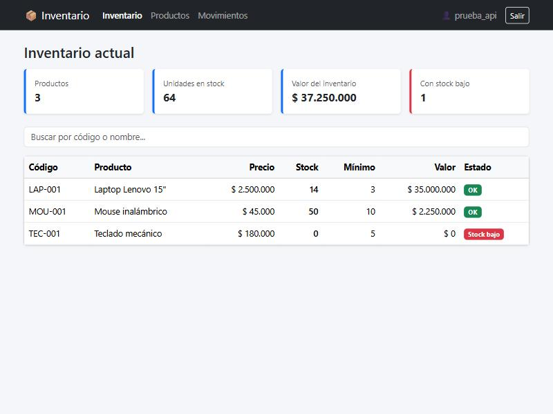
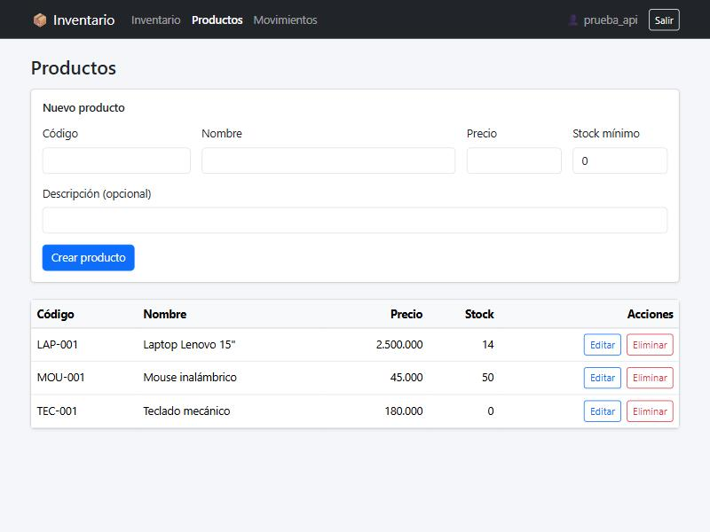
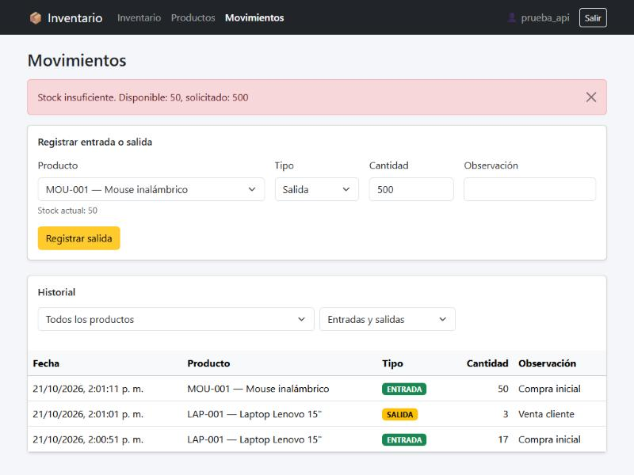
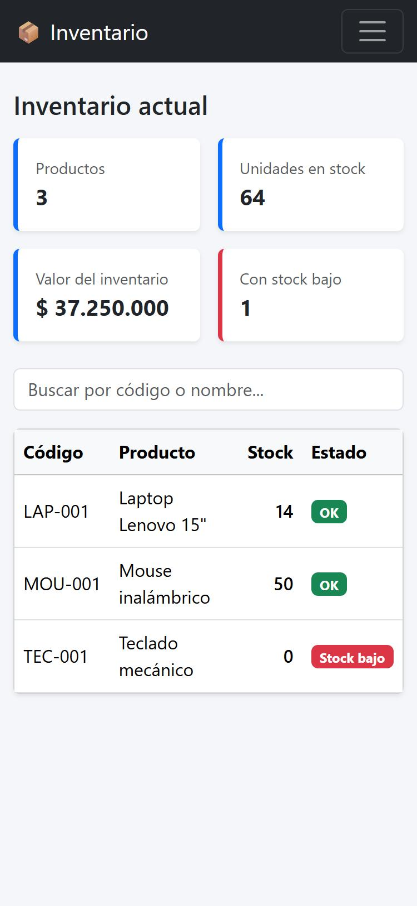
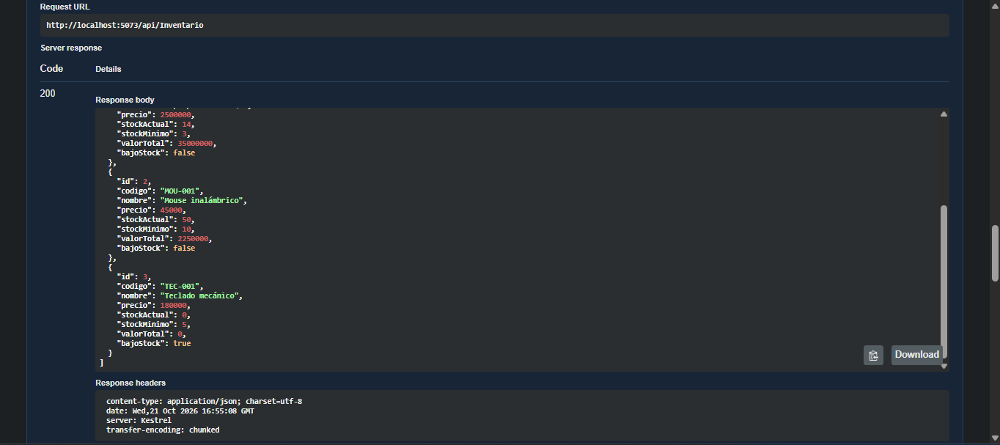

# Sistema de Gestión de Inventario

Aplicación web para controlar el inventario de productos: registro de entradas y salidas, consulta del stock actual e historial de movimientos. Prueba técnica con **API REST en C# (.NET 10)**, **PostgreSQL** y **frontend en React**.

## Características

- Autenticación con **JWT** (registro e inicio de sesión, contraseñas con hash BCrypt).
- CRUD de productos con validaciones.
- Entradas y salidas de inventario mediante **stored procedures** de PostgreSQL (con control de stock insuficiente).
- Inventario actual mediante una **función** de PostgreSQL, con alerta visual de **stock bajo**.
- Historial de movimientos con filtros por producto y tipo.
- Manejo global de errores en la API (respuestas JSON uniformes con el código HTTP correcto) y mensajes claros en el frontend.
- Diseño responsivo con Bootstrap 5 (en móvil se ocultan las columnas secundarias de las tablas).
- Extras más allá de los requisitos: alerta de stock bajo, tarjetas resumen con el valor del inventario, buscador, validaciones en cliente y servidor, y Swagger con soporte para JWT.

## Tecnologías

| Capa | Tecnología |
|---|---|
| Base de datos | PostgreSQL 18 |
| Backend | ASP.NET Core Web API (.NET 10), Entity Framework Core + Npgsql, JWT Bearer, BCrypt, Swagger |
| Frontend | React 19, Vite, React Router, Axios, Bootstrap 5 |

## Estructura del proyecto

```
├─ database/                  Scripts SQL (tablas, procedures/función, datos de prueba)
├─ backend/InventarioApi/     API: Controllers, Services, Data, Models, DTOs, Middleware, Exceptions
├─ frontend/inventario-web/   Aplicación React (api, context, components, pages)
└─ docs/capturas/             Capturas de pantalla
```

## Requisitos

- [.NET SDK 10](https://dotnet.microsoft.com/download)
- [PostgreSQL 16 o superior](https://www.postgresql.org/download/) (con pgAdmin)
- [Node.js 20 o superior](https://nodejs.org/)

## Cómo ejecutarlo

### 1. Base de datos

1. En pgAdmin crea una base de datos llamada `inventario_db`.
2. Abre la *Query Tool* sobre esa base y ejecuta, en este orden:
   1. `database/01_tablas.sql`
   2. `database/02_funciones_procedimientos.sql`
   3. `database/03_datos_prueba.sql` (opcional: 3 productos de ejemplo)

### 2. Backend

Los secretos **no** están en el repositorio. Guárdalos con User Secrets (reemplaza `TU_CLAVE`):

```bash
cd backend/InventarioApi
dotnet user-secrets set "ConnectionStrings:DefaultConnection" "Host=localhost;Port=5432;Database=inventario_db;Username=postgres;Password=TU_CLAVE"
dotnet user-secrets set "Jwt:Key" "una-clave-larga-y-aleatoria-de-minimo-32-caracteres"
dotnet run --launch-profile http
```

La API queda en `http://localhost:5073` y Swagger en `http://localhost:5073/swagger`.

> Para usar Swagger: haz `POST /api/auth/login`, copia el `token` y pégalo en el botón **Authorize**.

### 3. Frontend

```bash
cd frontend/inventario-web
npm install
npm run dev
```

Abre `http://localhost:5173`, crea una cuenta con **Registrarme** y entra. Si tu API corre en otra dirección, copia `.env.example` como `.env` y ajusta `VITE_API_URL`.

## Endpoints principales

| Método | Ruta | Descripción | Auth |
|---|---|---|---|
| POST | `/api/auth/register` | Crear usuario | No |
| POST | `/api/auth/login` | Obtener token JWT | No |
| GET/POST | `/api/productos` | Listar / crear productos | Sí |
| GET/PUT/DELETE | `/api/productos/{id}` | Ver / editar / eliminar | Sí |
| GET | `/api/inventario` | Inventario actual (función SQL) | Sí |
| POST | `/api/inventario/entrada` | Registrar entrada (procedure) | Sí |
| POST | `/api/inventario/salida` | Registrar salida (procedure) | Sí |
| GET | `/api/inventario/movimientos?productoId=&tipo=` | Historial con filtros | Sí |

## Decisiones de diseño

- **Stock en la tabla `productos` + historial en `movimientos`:** consultar el inventario es rápido y la base impide stock negativo con un `CHECK`.
- **Procedures para escribir y función para leer:** en PostgreSQL un `PROCEDURE` ejecuta acciones (`CALL`), mientras que una `FUNCTION` puede devolver una tabla (`SELECT`).
- **`FOR UPDATE` en las salidas:** bloquea la fila del producto para que dos salidas simultáneas no dejen el stock mal calculado.
- **Sin migraciones de EF:** el esquema lo definen los scripts SQL de `database/`.
- **Historial con `producto_id`:** los movimientos solo guardan el id del producto, así que si se edita el nombre, el historial muestra el nombre actual.
- **Observación opcional:** al registrar un movimiento la observación no es obligatoria a propósito, para agilizar la captura.
- **Rutas del frontend:** el inventario es la ruta `/`; `/inventario` redirige a `/`.
- **Errores:** los `RAISE EXCEPTION` de los procedures llegan como HTTP 400, los duplicados como 409 y los fallos inesperados como 500 sin exponer detalles internos.

## Flujo de trabajo con Git

Ramas `main` (estable), `develop` (integración) y `feature/phase-N-descripcion` por fase, con *pull requests* hacia `develop` y un PR final de `develop` a `main`. Commits con formato convencional (`feat:`, `fix:`, `docs:`, `chore:`).

## Capturas de pantalla

| Inventario actual (alerta de stock bajo) | Productos |
|---|---|
|  |  |

| Error de stock insuficiente (viene del stored procedure) | Vista móvil |
|---|---|
|  |  |

**Swagger con sesión autorizada** (respuesta 200 de `GET /api/inventario`, que usa la función SQL):



## Mejoras futuras

- Paginación en inventario e historial.
- Filtro del historial por rango de fechas.
- Exportar el inventario a Excel/CSV.
- Roles (administrador / operador) para restringir el borrado de productos.
